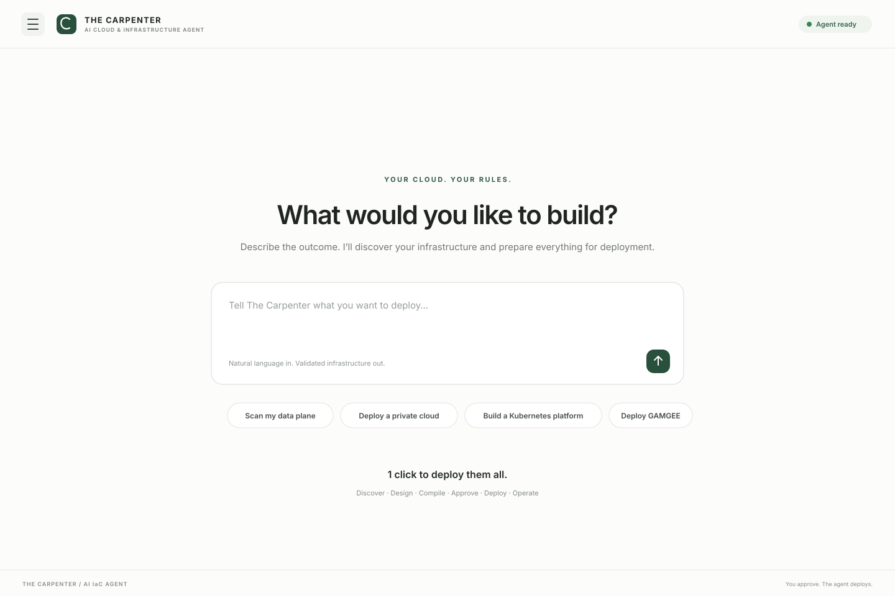

# The Carpenter
### AI Cloud Deployment Agent · AI Infrastructure-as-Code Agent
### One Agent That Rules Them All.

<p align="center">
  
</p>

<p align="center"><em>Prompt-first by design: discover, design, compile, approve and deploy — without asking users to author IaC.</em></p>


**The Carpenter is an AI Agent that turns natural-language infrastructure goals into deployed cloud environments.** It discovers the user's infrastructure, understands the desired outcome, designs the target architecture, generates the required Infrastructure-as-Code (IaC), validates it, onboards the selected providers, provisions resources and verifies the result.

Users describe *what they want*. They do not have to author YAML, Terraform, Ansible, cloud-init or provider API payloads. The Carpenter generates and manages those implementation artifacts internally, then applies them through its distributed Python FaaS workers.

> **The Carpenter is the AI control plane. The user's servers and provider endpoints are the data plane.** GAMGEE is optional: the agent can onboard GAMGEE Cloud or construct an independent IaaS/PaaS/hybrid environment.

The experience is intentionally prompt-first. The agent owns the infrastructure workflow—from discovery and IaC generation to provider execution and result reconciliation—while deterministic policy, validation and approval controls govern infrastructure mutations.

## Contents

- [Principles and architecture](#principles-and-architecture)
- [Implementation status](#implementation-status)
- [Quick start](#quick-start)
- [Authentication and roles](#authentication-and-roles)
- [Enrol data-plane servers](#enrol-data-plane-servers)
- [Configure cloud adapters](#configure-cloud-adapters)
- [Use the deployment lifecycle](#use-the-deployment-lifecycle)
- [Operate and inspect](#operate-and-inspect)
- [API reference](#api-reference)
- [Tests](#tests)
- [Security and production readiness](#security-and-production-readiness)
- [Technical documentation](#technical-documentation)

---


## Living Infrastructure Canvas (0.5.0)

The authenticated web console is now a visual-first, transparent workflow canvas with a porcelain-white theme, soft neutral surfaces and restrained teal/blue status accents. The Carpenter begins as a single launcher node and presents the infrastructure journey as connected, selectable stages: intent, discovery, blueprint, playbook, versioned native functions, deterministic IaC, human approval, distributed provisioning and reconciliation.

- **Graph view:** dependency edges and expandable workflow nodes make the build sequence visible at a glance.
- **Status language:** dormant, in progress, complete and attention states use distinct, accessible color treatments.
- **Node inspector:** select any node to inspect its purpose, role, dependency and execution boundary.
- **Execution journal:** recent conversation entries are visible alongside the graph.
- **Prompt dock:** the natural-language composer remains available while the canvas is in view.
- **White visual system:** a light, low-glare interface keeps the graph, dependency paths and execution status legible without dark panels or neon effects.
- **Honest state representation:** the current UI derives visible state from the saved conversation response. It does not claim to be a live event stream; real-time worker telemetry and event-driven graph updates remain a follow-on integration.

The Blueprint and Playbook nodes are visual workflow concepts in this release. They do not imply that separate workbook or playbook files are persisted. The existing saved deployment plan, IaC resource graph, approval and distributed FaaS job lifecycle remain the authoritative execution records.

## Principles and architecture

1. **AI Agent first.** A goal-driven agent interprets requirements, discovers infrastructure, builds a deployment plan and orchestrates the full lifecycle.
2. **AI IaC, not manual IaC.** The agent compiles validated intent into deterministic resource graphs and provider manifests. Users do not write YAML/Terraform to provision supported resources.
3. **Python 100%.** API, orchestration, IaC compiler, workers, adapters and FaaS functions are Python. The UI is server-rendered HTML/CSS.
4. **Control plane / data plane separation.** The Carpenter coordinates; user-owned servers and provider APIs provide compute, storage and network.
5. **Two cloud choices.** GAMGEE onboarding or independent IaaS/PaaS/hybrid. Neither option is forced.
6. **Native distributed FaaS.** All provider operations are versioned Python functions executed by workers.
7. **Safe autonomy.** The model proposes intent; deterministic compilers, validators, policy and adapters control what can execute.

```text
                 USER
                  |
          Minimal Web Prompt
                  |
            Python API
                  |
          THE CARPENTER AGENT
        Intent • Plan • Policy
                  |
         Distributed Python FaaS
        Queue • Versions • Leases
             /    |     \
          Node A Node B Node C
             \    |     /
             USER DATA PLANE
     Servers • Hypervisors • Storage
                  |
          +-------+--------+
          |                |
     GAMGEE CLOUD       OWN CLOUD
      optional          IaaS / PaaS
          +-------+--------+
                  |
            OPERATIONS ENGINE
        Metrics • HA • Failover • LB
```

## Implementation status

<badge color="success">CI tests passing</badge> <badge color="info">Early engineering foundation</badge>

| Programme | Implemented in this increment | Still required for production |
|---|---|---|
| AI Agent & workflow | Natural-language requirement extraction, session context, discovery orchestration, deterministic IaC generation, saved plans, chat-based approval/deploy/status actions and provider function dispatch | OIDC/SAML SSO, individual user identity/federation, longer-running task memory and recovery loops |
| AI IaC Engine | Deterministic desired-state resource graph, Proxmox/GAMGEE plans, Kubernetes YAML manifests, SHA-256 fingerprint and worker-side validation | More providers, Terraform/OpenTofu generation, dependency graph, drift detection and change/destroy plans |
| Distributed Native FaaS | Durable SQLite queue, versioned functions, targeted workers, leases, retries/backoff, idempotency and dead-letter state | Shared PostgreSQL queue, isolated workers, signed function packages and multi-tenant quotas |
| Infrastructure Discovery | Per-node CPU/RAM/disk/OS/network facts, KVM/libvirt/Proxmox detection and targeted read-only probes | Hypervisor API inventory, IOPS/network benchmarks, GPU/NUMA and full failure-domain topology |
| Intelligent Resource Engine | Per-host placement, CPU/RAM/disk headroom, HA spread and basic capacity forecast | Reservations, workload-aware bin packing, NUMA/GPU/IOPS and cost models |
| Dual Cloud Deployment | Approved IaC plans dispatch GAMGEE, Proxmox and Kubernetes Python FaaS jobs; status reconciles from worker results | GAMGEE installer service, bare-metal Kubernetes bootstrap, storage/network/image automation and compensation |
| Web identity and authorisation | Admin/operator/viewer token roles, HMAC-signed expiring sessions, HttpOnly/SameSite cookies, CSRF validation, logout and admin-only chat approval/execution | OIDC/SAML SSO, per-user directory mapping, central session revocation and fine-grained project/tenant policies |
| Autonomous Operations | Worker metrics, HA assessment, scale recommendations, failover placement and HAProxy config planning | Live SLO/alert pipeline, autonomous policy-bounded remediation, fencing, drain, rollback and recovery |

**IaC principle:** the generated resource graph and YAML are Carpenter-owned artifacts. The user supplies requirements, not manifests. The current compiler supports Proxmox VM plans, Kubernetes Deployment/Service manifests and a GAMGEE bootstrap plan; it does not yet generate general-purpose Terraform/OpenTofu or Ansible projects.

**Execution boundary:** provider operations run as native Python FaaS jobs on workers with the required capability. Proxmox/Kubernetes/GAMGEE credentials stay on those workers. GAMGEE needs a compatible installer endpoint; own-cloud PaaS currently targets an existing Kubernetes cluster.

---

## Quick start

### Requirements

- Docker Engine 24+.
- Docker Compose v2.
- Python 3.12+ on each data-plane server that will run a worker.
- A local TCP port (default 8000).

### 1. Clone and configure

```bash
git clone https://github.com/roime81/The-Carpenter.git
cd The-Carpenter
cp .env.example .env
```

Generate separate high-entropy values:

```bash
python -c "import secrets; print(secrets.token_urlsafe(48))"
```

Set unique values for the required `CARPENTER_ADMIN_TOKEN`, `CARPENTER_AGENT_ENROLLMENT_TOKEN` and `CARPENTER_SESSION_SECRET`. Optionally configure different `CARPENTER_OPERATOR_TOKEN` and `CARPENTER_VIEWER_TOKEN` credentials. Never reuse the worker enrollment token as a browser credential. Do not use the example placeholders.

For a local-only demo, leave worker provider credentials empty. You can still run the prompt UI, inspect the health endpoint, generate IaC plans and inspect the generated resource graph. Actual provisioning requires enrolled execution workers and configured provider endpoints.

### 2. Start The Carpenter control plane

```bash
docker compose up --build -d
docker compose logs -f carpenter
```

Open:

- **Prompt UI:** http://localhost:8000
- **Health:** http://localhost:8000/health
- **Interactive API docs:** http://localhost:8000/docs
- **Versioned function catalogue:** http://localhost:8000/api/v1/functions

Stop the platform:

```bash
docker compose down
```

The SQLite database is persisted in the `carpenter-data` Docker volume. To remove it as well, run `docker compose down -v` (destructive).

---

## Authentication and roles

The browser console is not anonymous. A user signs in at `/login` with one of the configured web access tokens. The token is checked by the control plane and exchanged for a short-lived signed browser session; the original token is not placed in the browser cookie or conversation.

| Role | Browser access | Infrastructure authority |
|---|---|---|
| **Admin** | Full prompt and conversation access | Create plans, inspect IaC, approve and execute deployments |
| **Operator** | Full prompt and conversation access | Discover the environment and create/revise plans; cannot approve or execute |
| **Viewer** | Read-only conversation view | Cannot submit prompts or mutate infrastructure |

The admin credential is `CARPENTER_ADMIN_TOKEN`. Optional `CARPENTER_OPERATOR_TOKEN` and `CARPENTER_VIEWER_TOKEN` values enable the other roles. Use different, independently generated values. The existing `CARPENTER_AGENT_ENROLLMENT_TOKEN` remains dedicated to Node Agent authentication and is not a browser role.

Generate independent secrets with:

```bash
python -c "import secrets; print(secrets.token_urlsafe(48))"
```

Set a different generated value for each configured token. Also set `CARPENTER_SESSION_SECRET` to a dedicated random value. When omitted, the control plane falls back to the admin token for session signing; a dedicated value is recommended.

**Browser session controls**

- Sessions are HMAC-SHA256 signed and expire after 12 hours.
- The authentication cookie is HttpOnly and SameSite=Strict; set `CARPENTER_COOKIE_SECURE=true` when the console is served over HTTPS.
- The prompt and logout forms include a session-bound CSRF token.
- The conversation identifier is a distinct UUID claim inside the signed authentication cookie; it is freshly generated at login and cannot be selected or swapped through an unsigned browser cookie.
- Logout clears the browser cookies. Because sessions are stateless in this release, a copied cookie remains valid until expiry unless the signing secret is rotated.
- The configured tokens are shared role credentials, not individual user accounts. Audit events distinguish the role principal (for example, `web-admin`) and action source, but do not prove which human used a shared token.

This is built-in token-based RBAC for the current single-control-plane product. OIDC/SAML SSO, corporate directory integration, per-user entitlements, and centrally revocable sessions are not claimed as implemented.

---

## Enrol data-plane servers

The Node Agent is both an inventory reporter and a distributed Python FaaS worker. Run it on every server that The Carpenter is authorised to manage. It makes outbound connections; it does not expose an inbound command listener.

### Linux

```bash
git clone https://github.com/roime81/The-Carpenter.git
cd The-Carpenter
python3 -m venv .venv
source .venv/bin/activate
pip install -r node_agent/requirements.txt

export CARPENTER_URL="https://carpenter.example.com"
export CARPENTER_AGENT_TOKEN="the-same-node-enrolment-secret-from-.env"
export CARPENTER_FAILURE_DOMAIN="rack-a"
python node_agent/agent.py
```

### Windows PowerShell

```powershell
git clone https://github.com/roime81/The-Carpenter.git
cd The-Carpenter
py -3.12 -m venv .venv
.\.venv\Scripts\Activate.ps1
pip install -r node_agent/requirements.txt

$env:CARPENTER_URL = "https://carpenter.example.com"
$env:CARPENTER_AGENT_TOKEN = "the-same-node-enrolment-secret-from-.env"
$env:CARPENTER_FAILURE_DOMAIN = "rack-a"
python node_agent/agent.py
```

Run one agent per server. Use meaningful failure domains such as `rack-a`, `rack-b`, `zone-1` or separate sites; nodes sharing a power/network/storage failure must not be assigned fake independent domains.

The agent sends heartbeats every 30 seconds and polls the FaaS queue every 2 seconds by default. Adjust with `CARPENTER_HEARTBEAT_SECONDS` and `CARPENTER_WORKER_POLL_SECONDS`. Nodes older than `CARPENTER_AGENT_STALE_SECONDS` (default 90 seconds) are excluded from live capacity.

The agent performs discovery, constructs the desired state, compiles a provider-specific IaC bundle and dispatches the generated resources to worker functions for apply. Current built-in functions include read-only discovery/metrics plus Proxmox VM creation, Kubernetes Deployment/Service apply and signed GAMGEE bootstrap. Provider functions are advertised only when the relevant worker has its endpoint and credentials configured. Workers execute only shipped, versioned Python handlers; they never execute arbitrary shell or model-generated Python.

For service management and the exact worker protocol, see [docs/DISTRIBUTED-FAAS.md](docs/DISTRIBUTED-FAAS.md).

---

## Configure cloud adapters

Provider credentials are stored on the specific data-plane execution workers, not in the Carpenter control-plane `.env`. A worker advertises its provider FaaS function only when its local configuration is complete. Restart the Node Agent after adding or changing a provider configuration.

### Option A — GAMGEE Cloud

On one trusted worker with network access to the GAMGEE installer endpoint:

```bash
export CARPENTER_GAMGEE_INSTALLER_URL="https://gamgee-installer.example.com/api/v1/bootstrap"
export CARPENTER_GAMGEE_INSTALLER_TOKEN="your-hmac-signing-secret"
```

That worker advertises `gamgee.bootstrap@1.0.0`. The installer endpoint must implement the signed request contract in [docs/DEPLOYMENT.md](docs/DEPLOYMENT.md). This repository does not invent or bundle GAMGEE's installer internals.

### Option B — independent IaaS with Proxmox VE

On each Proxmox host that The Carpenter may use for VM placement:

```bash
export CARPENTER_PROXMOX_URL="https://pve.example.com:8006"
export CARPENTER_PROXMOX_TOKEN_ID="carpenter@pve!launcher"
export CARPENTER_PROXMOX_TOKEN_SECRET="your-proxmox-api-token-secret"
export CARPENTER_PROXMOX_NODE="pve-node-01"
export CARPENTER_PROXMOX_TEMPLATE_VMID="9000"
```

Prepare a cloud-init-capable VM template in Proxmox first. The agent must run on the configured Proxmox host. The worker advertises `compute.proxmox_deploy@1.0.0`. The adapter clones the template, applies vCPU/RAM sizing, waits for Proxmox tasks and starts one VM per FaaS job. Storage/network profiles, disk resizing and per-VM cloud-init customisation are not implemented yet.

### Option B — independent PaaS with Kubernetes

On a worker that can reach the intended Kubernetes API:

```bash
export CARPENTER_KUBERNETES_API_URL="https://kubernetes.example.com:6443"
export CARPENTER_KUBERNETES_TOKEN="your-narrowly-scoped-service-account-token"
```

The worker advertises `platform.kubernetes_deploy@1.0.0`. It deploys a generated Kubernetes Deployment and ClusterIP Service using server-side apply. The Kubernetes cluster and namespace must already exist. The service account should be restricted to the intended namespace and required resource types.

The current PaaS function does not bootstrap Kubernetes on bare metal. That is a future provider/bootstrap capability.

Full worker-side environment details and adapter contracts are in [docs/DEPLOYMENT.md](docs/DEPLOYMENT.md).

---

## Use the AI deployment agent

Describe the desired outcome in the prompt—for example:

```text
Build my own PaaS cloud for the inventory API.
Deploy 3 replicas using ghcr.io/example/inventory:v1.
Each replica needs 2 vCPU and 4 GB RAM.
Expose it internally on port 8080.
```

The Carpenter interprets the request, discovers available provider workers, creates the desired-state resource graph, compiles the Kubernetes YAML internally, validates the bundle and prepares the deployment. You do not need to write or upload YAML.

For supported infrastructure changes, the browser experience now supports the full conversational approval and dispatch sequence. An operator can create and refine a plan; an admin must explicitly approve it before any provider function is queued.

### Conversational deployment lifecycle

1. **Describe the outcome.** State the destination, service model, workload, sizing and desired availability in natural language.
2. **Discover and design.** The agent assesses online enrolled workers, available provider capabilities, CPU/RAM/disk headroom and placement constraints.
3. **Compile and validate.** The deterministic compiler produces the saved `carpenter.iac/v1` resource graph and provider artifacts. It verifies allow-listed resource kinds, artifact hashes, graph fingerprint and safe YAML parsing.
4. **Review the plan.** The response displays the deployment ID, full IaC fingerprint, resources, generated artifact filenames, readiness checks and any blockers. No resources have changed.
5. **Approve.** An admin types `approve` in the same conversation. Approval is attached to that conversation's saved deployment and records the admin role principal and IaC fingerprint in the event log. For an operator-to-admin handoff, the operator shares the saved deployment UUID; the admin can use the explicit-ID commands below from a separate signed-in session.
6. **Execute.** The admin types `deploy`, or uses the explicit combined command `approve and deploy`. For a handed-off plan, use `deploy <deployment-id>` or `approve and deploy <deployment-id>`. The Carpenter revalidates the stored IaC bundle, live capacity, placement and provider-worker assignment before dispatching versioned Python FaaS jobs.
7. **Reconcile.** The user types `status` to see deployment and per-worker job state. A deployment is `succeeded` only after all linked jobs succeed; dead-lettered jobs cause a failed deployment.

The accepted chat action phrases are:

| Prompt | Action |
|---|---|
| `approve` | Approve the current saved plan; do not dispatch yet |
| `deploy` | Execute a plan that is already approved |
| `approve and deploy` | Approve and immediately dispatch the current saved plan |
| `status` | Reconcile and display deployment/job status |
| `approve deployment <deployment-id>` | Approve a saved plan handed off from another browser session |
| `deploy <deployment-id>` | Execute that deployment after it has been approved |
| `approve and deploy <deployment-id>` | Approve and dispatch a handed-off plan in one explicit admin command |
| `status <deployment-id>` | Inspect a handed-off deployment and its provider jobs |

Replace `<deployment-id>` with the UUID returned when the plan is created. The ID is an explicit reference, not an authorisation token: role checks and saved-plan readiness validation still apply.

These are control commands, not LLM-generated actions. The prompt handler recognises the fixed phrases and calls the same approval/execution functions as the administrative API. The model cannot self-approve, bypass readiness checks, or execute arbitrary code. A viewer cannot submit commands; an operator receives an explicit admin-role denial for approval or execution.

If any readiness check fails, the admin command is refused with the reason. Correct the infrastructure/provider configuration or revise the requirements to create a new plan. A changed placement or worker assignment requires a fresh plan and fresh approval; the previous approval is not silently reused.

### 1. Create a plan through the API (optional)


```bash
curl -X POST http://localhost:8000/api/v1/deployments/plan \
  -H "X-Carpenter-Token: $CARPENTER_ADMIN_TOKEN" \
  -H "Content-Type: application/json" \
  -d '{
    "destination": "own_cloud",
    "service_model": "iaas",
    "vm_count": 2,
    "vcpu_per_vm": 4,
    "memory_gb_per_vm": 16,
    "disk_gb_per_vm": 100,
    "high_availability": true,
    "name": "app-node"
  }'
```

The response includes a `deployment_id`, capacity/HA/worker readiness checks, the generated IaC resource graph and its immutable fingerprint.

### 2. Inspect generated IaC and approve the exact plan

Inspect the generated YAML/resource graph (admin access required):

```bash
curl http://localhost:8000/api/v1/deployments/DEPLOYMENT_ID/iac \
  -H "X-Carpenter-Token: $CARPENTER_ADMIN_TOKEN"
```

```bash
curl -X POST http://localhost:8000/api/v1/deployments/DEPLOYMENT_ID/approve \
  -H "X-Carpenter-Token: $CARPENTER_ADMIN_TOKEN" \
  -H "Content-Type: application/json" \
  -d '{"approved_by":"api-admin"}'
```

The legacy `approved_by` request field is not trusted as an identity claim. The API audit event records the authenticated administrative API principal as `api-admin`.

### 3. Execute

```bash
curl -X POST http://localhost:8000/api/v1/deployments/DEPLOYMENT_ID/execute \
  -H "X-Carpenter-Token: $CARPENTER_ADMIN_TOKEN"
```

Execution is refused unless the stored plan passed its readiness checks and was approved. The execute endpoint returns `queued` with FaaS job IDs; poll `GET /api/v1/deployments/DEPLOYMENT_ID` for linked worker status and results. The API path and browser chat path call the same approval and execution helpers. A deployment becomes `succeeded` only after all linked jobs succeed. Hybrid deployments can partially succeed; compensation/rollback across independent providers is not yet implemented.

---

## Operate and inspect

### Inventory

```bash
curl http://localhost:8000/api/v1/inventory \
  -H "X-Carpenter-Token: $CARPENTER_ADMIN_TOKEN"
```

### Queue discovery on every online node

```bash
curl -X POST http://localhost:8000/api/v1/discovery/scan \
  -H "X-Carpenter-Token: $CARPENTER_ADMIN_TOKEN"
```

The response returns the targeted worker jobs. Results appear in `GET /api/v1/jobs`.

### Collect metrics from every online worker

```bash
curl -X POST http://localhost:8000/api/v1/operations/metrics/collect \
  -H "X-Carpenter-Token: $CARPENTER_ADMIN_TOKEN"

curl http://localhost:8000/api/v1/operations/metrics \
  -H "X-Carpenter-Token: $CARPENTER_ADMIN_TOKEN"
```

### HA, scaling and load-balancer planning

- `POST /api/v1/operations/ha-assessment`
- `POST /api/v1/operations/recommendation`
- `POST /api/v1/operations/failover-plan`
- `POST /api/v1/operations/load-balancer/plan`
- `GET /api/v1/operations/events`

These APIs produce assessments and plans. They do not yet perform autonomous load-balancer reloads, data failover or closed-loop scaling. See [docs/OPERATIONS.md](docs/OPERATIONS.md).

---

## API reference

| Method | Endpoint | Purpose |
|---|---|---|
| GET | `/health` | Liveness |
| GET | `/login` | Web console sign-in |
| POST | `/login` | Exchange a configured role token for a signed browser session |
| POST | `/logout` | Clear the authenticated browser session (CSRF protected) |
| GET | `/api/v1/functions` | Function/version catalogue |
| GET | `/api/v1/inventory` | Enrolled node inventory (admin) |
| POST | `/api/v1/agents/heartbeat` | Worker heartbeat |
| POST | `/api/v1/jobs` | Enqueue FaaS job (admin) |
| GET | `/api/v1/jobs` | List jobs (admin) |
| GET | `/api/v1/jobs/{id}` | Get job result/status (admin) |
| POST | `/api/v1/workers/{id}/claim` | Claim work (worker) |
| POST | `/api/v1/workers/{id}/jobs/{job}/complete` | Complete leased job (worker) |
| POST | `/api/v1/workers/{id}/jobs/{job}/fail` | Fail leased job (worker) |
| POST | `/api/v1/discovery/scan` | Queue fleet discovery (admin) |
| POST | `/api/v1/resources/plan` | Non-mutating placement plan (admin) |
| POST | `/api/v1/resources/forecast` | Simple capacity forecast (admin) |
| POST | `/api/v1/deployments/plan` | Create dual-cloud deployment plan |
| GET | `/api/v1/deployments/{id}` | Read plan and reconcile linked FaaS job results |
| GET | `/api/v1/deployments/{id}/iac` | Inspect generated IaC artifacts and fingerprint |
| POST | `/api/v1/deployments/{id}/approve` | Approve saved plan |
| POST | `/api/v1/deployments/{id}/execute` | Dispatch approved provider FaaS jobs |
| POST | `/api/v1/operations/metrics/collect` | Queue node metrics |
| GET | `/api/v1/operations/metrics` | Read metrics job results |
| POST | `/api/v1/operations/ha-assessment` | HA readiness check |
| POST | `/api/v1/operations/recommendation` | Scale/operation recommendation |
| POST | `/api/v1/operations/failover-plan` | Recovery placement plan |
| POST | `/api/v1/operations/load-balancer/plan` | HAProxy config plan |
| GET | `/api/v1/operations/events` | Operation audit events |

Administrative endpoints require `X-Carpenter-Token`; worker endpoints require `X-Agent-Token`. Interactive API documentation is at `/docs`.

---

## Tests

Python 3.12+:

```bash
pip install -r requirements.txt
PYTHONPATH=backend python -m unittest discover -s tests -v
```

GitHub Actions runs the unit suite on pushes to `main` and pull requests.

---

## Security and production readiness

This is an early engineering foundation, not a production-ready multi-tenant cloud control plane.

- The node enrollment token is shared across workers in this first increment. Production requires per-node identity, short-lived credentials and mTLS.
- Web role tokens are shared credentials, not personal identities. For enterprise use, integrate OIDC/SAML or a trusted identity provider and map individual users/groups to deployment permissions.
- Stateless browser sessions cannot be individually revoked server-side before expiry. Rotate `CARPENTER_SESSION_SECRET` to invalidate all browser sessions, or add a centrally managed session store for production.
- Set `CARPENTER_COOKIE_SECURE=true` behind HTTPS. Do not expose the development console over public HTTP.
- The browser includes token-based admin/operator/viewer RBAC, signed 12-hour sessions and form CSRF validation; OIDC/SAML SSO, individual user identities and central session revocation are not yet implemented.
- The queue is durable SQLite for a single control-plane instance. Multi-replica deployment needs shared transactional storage and distributed scheduling.
- Function versions are matched, but worker packages are not yet cryptographically signed or verified.
- FaaS is at-least-once. Mutating functions need idempotency and compensation.
- Proxmox, Kubernetes and GAMGEE credentials are kept in worker environment variables in this build; production requires per-worker identity and a secrets manager.
- PaaS requires an existing Kubernetes cluster; GAMGEE requires a compatible external installer endpoint.
- HA, failover, autoscaling and load balancing currently produce policies/plans; they are not fully autonomous closed-loop operations.
- PaaS HA plans are deliberately blocked until Kubernetes node/zone/control-plane/storage topology discovery can verify the cluster itself; multiple API-reachable workers are not treated as proof of cluster HA.

Read [docs/SECURITY.md](docs/SECURITY.md) before connecting real infrastructure.

## Technical documentation

- [AI Cloud Deployment Agent](docs/AI-AGENT.md)
- [AI Infrastructure-as-Code Engine](docs/IAC-ENGINE.md)
- [Architecture](docs/ARCHITECTURE.md)
- [Distributed FaaS](docs/DISTRIBUTED-FAAS.md)
- [Infrastructure Discovery](docs/DISCOVERY.md)
- [Resource Engine](docs/RESOURCE-ENGINE.md)
- [Dual Cloud Deployment](docs/DEPLOYMENT.md)
- [Autonomous Operations](docs/OPERATIONS.md)
- [Function Model](docs/FUNCTIONS.md)
- [Security](docs/SECURITY.md)
- [Engineering Roadmap](docs/ROADMAP.md)
- [Changelog](CHANGELOG.md)

## Repository structure

```text
.
├── backend/app/
│   ├── adapters/              # Provider adapter references
│   ├── runtime/               # Local Python function runtime
│   ├── main.py                # Python control-plane API and chat action routing
│   ├── web_auth.py             # Signed browser sessions, role credentials and CSRF validation
│   ├── store.py               # Queue, worker, inventory and deployment store
│   ├── iac_engine.py          # Deterministic desired-state to IaC compiler
│   ├── deployment_engine.py   # AI plan and distributed apply coordinator
│   ├── resource_engine.py     # Placement and forecasting
│   ├── operations_engine.py   # HA, recovery and LB planning
│   └── worker_catalogue.py    # Versioned worker functions
├── node_agent/
│   ├── agent.py               # Outbound worker process
│   └── handlers.py            # Allow-listed local Python handlers
├── docs/
├── tests/
├── Dockerfile
├── docker-compose.yml
├── requirements.txt
└── README.md
```

## License

No license has been selected yet. Until one is added, all rights are reserved by the repository owner.
