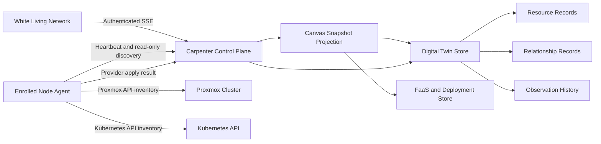

# Infrastructure Digital Twin

The Carpenter's Infrastructure Digital Twin is the observed-state model behind the Living Infrastructure Network. It is designed to represent real provider resources and their relationships, not only the sequence of agent workflow steps.

## Design principles

1. **Observed, not assumed.** Planned IaC resources do not become topology objects until a worker or provider adapter reports them.
2. **Stable identity.** Each resource is identified by provider plus a provider-native identity, normalized into a deterministic Carpenter resource ID.
3. **Typed resources and edges.** Hosts, hypervisors, VMs, clusters, namespaces, workloads, services, networks, interfaces, storage pools and volumes have explicit types and relationship semantics.
4. **Append-only observation history.** First-seen and last-seen timestamps, resource versions and change snapshots preserve the history of observed state.
5. **Provider boundaries.** Provider credentials remain on data-plane workers. The control plane stores only normalized resource facts and selected allow-listed properties.
6. **One network, two lenses.** The same mesh can show execution activity and the physical/logical infrastructure topology; graph filters allow either view to be inspected without creating a second canvas.

## Architecture

The SQLite store has three twin-specific tables:

| Table | Purpose |
|---|---|
| `twin_resources` | Current typed resource record, stable identity, status, selected properties, source and timestamps |
| `twin_relationships` | Directed relationships between two observed resources |
| `twin_observations` | Versioned snapshots for resource creation or material changes |

The workflow database remains authoritative for deployment plans, approvals, FaaS jobs and execution status. The twin is authoritative for the control plane's current observed topology.

## Resource identity

A resource's public Carpenter ID is derived from a canonical pair:

- `provider`: e.g. `proxmox`, `kubernetes`, `carpenter-agent`, `linux-network`.
- `native_id`: a provider-specific identifier, qualified by endpoint or host when needed.

The pair is hashed to create a stable `twin:<digest>` graph-node ID. This avoids using a VM ID or Kubernetes namespace alone where that identifier can be repeated in another cluster.

Examples:

| Provider | Native identity example | Type |
|---|---|---|
| `carpenter-agent` | `worker-01` | `compute_host` |
| `proxmox` | `nodes/pve.example:8006/pve-01` | `hypervisor_node` |
| `proxmox` | `qemu/pve.example:8006/101` | `virtual_machine` |
| `proxmox` | `network/pve.example:8006/pve-01/vmbr0` | `network` |
| `kubernetes` | `api/kube.example:6443` | `cluster` |
| `kubernetes` | `deployments/kube.example:6443/production/web` | `workload` |
| `kubernetes` | `services/kube.example:6443/production/web` | `service` |

A provider adapter can add new resource types or relationship types without changing the graph identity contract. The control plane rejects resource types that are not in the current allow-list.

## How state reaches the twin

### 1. Worker heartbeat

When an enrolled worker posts `POST /api/v1/agents/heartbeat`, the control plane updates its normal agent inventory and upserts a `compute_host` observation. The observation includes the worker hostname, OS, architecture, CPU count, memory/disk totals and available capacity, private IPv4 addresses, supported function names and heartbeat freshness.

The worker node is connected to the Carpenter control plane with a `manages` relationship.

### 2. Local read-only discovery

The baseline discovery functions inspect:

- Hypervisor presence: KVM device, libvirt socket/CLI and Proxmox host marker.
- Container runtime presence: Docker, Podman and containerd.
- Mounted storage: device, mountpoint, filesystem, total and free bytes.
- Network interfaces: link state, speed and private interface addresses.
- Subnets: derived only from explicitly observed private/loopback/link-local interface addresses and masks.

These are observations, not configuration changes. A Linux host volume is not presented as a cloud block volume, and a network interface does not imply that Carpenter manages the switch/router behind it.

### 3. Proxmox inventory

A worker advertises `discovery.proxmox_inventory@1.0.0` when its local Proxmox API URL and token credentials are configured. The function reads the Proxmox cluster resource list and selected QEMU guest configurations to discover:

- Proxmox cluster nodes and their returned status/capacity facts.
- QEMU and LXC guests.
- Storage pools reported in the cluster resource inventory.
- Virtual bridge names parsed from guest network configuration.
- Attached guest volumes parsed from disk configuration.

The inventory function is read-only. A bounded number of QEMU configuration reads are performed per refresh to avoid an unbounded API fan-out. Provider API failures cause the discovery job to fail and are visible in the execution journal.

### 4. Kubernetes inventory

A worker advertises `discovery.kubernetes_inventory@1.0.0` when its API URL and service-account token are configured. The function reads the configured namespace (environment variable `CARPENTER_KUBERNETES_NAMESPACE`, default `default`) and objects visible to that service account:

- Deployments, StatefulSets, DaemonSets and ReplicaSets.
- Services and service ClusterIP addresses.
- Pods, Pod IP addresses, restart counts and assigned Node names.
- PersistentVolumeClaims and their bound PersistentVolumes when the worker has permission to list PVs.

Relationships include namespace containment, Service-to-workload routing, ReplicaSet/controller ownership, Pod-to-ReplicaSet ownership, Pod scheduling and PVC-to-PV binding.

This inventory intentionally follows the configured namespace and RBAC boundary. It does not assume cluster-admin permission. If a collection is forbidden or unavailable, the discovery result records a warning and is marked incomplete; the control plane does not infer that absent objects were deleted.

### 5. Successful provider operations

When an FaaS worker reports a successful job, the control plane imports its normalized `observed_resources` and `observed_relationships` result. This happens after the worker has successfully completed its lease-protected job.

The Proxmox deployment worker verifies VM state/configuration after its provider calls and returns the VM's native VMID plus discovered bridge and volume attachments. The Kubernetes deployment worker reads the API responses for the applied Deployment and Service and returns their cluster-scoped identities and observed status.

If a provider result is not terminal success, no success observation is imported from that result. A failed FaaS job remains a failed execution node, not a falsely successful cloud resource.

## Refreshing topology

The console's **Refresh topology** action is available to authenticated operators and admins. It:

1. Validates the session and CSRF token.
2. Selects online enrolled workers.
3. Selects read-only discovery functions that each worker actually advertises.
4. Enqueues one bounded job per eligible worker/function pair.
5. Returns a refresh ID and job references.

The UI displays that work was queued. It does not optimistically create infrastructure objects. When worker results arrive, the twin upserts resources/edges and the regular canvas SSE snapshot reveals the observed changes.

The API can also be used directly by an authenticated console session:

| Method | Route | Access |
|---|---|---|
| GET | `/api/v1/twin/snapshot` | Signed-in console session |
| POST | `/api/v1/twin/refresh` | Operator/admin + `X-CSRF-Token` |
| GET | `/api/v1/twin/resources/{resource_id}/history` | Signed-in console session |
| GET | `/api/v1/canvas/snapshot` | Signed-in console session |
| GET | `/api/v1/canvas/stream` | Signed-in console session; SSE |

The twin snapshot is installation-wide and shared by authenticated users in this version. Execution/job history remains scoped to the signed-in conversation.

## Status and observation semantics

A resource status is the latest value reported by its source adapter. Examples include `online`, `offline`, `running`, `stopped`, `ready`, `applied`, `bound`, `mounted` or `observed`. The display palette maps these source values into waiting, active, succeeded/observed and failed states; the inspector retains the more specific status string.

Every material resource change increments `version` and inserts an observation snapshot with timestamp and previous status. An unchanged heartbeat updates `last_seen` without generating a new version on every heartbeat.

## Security and data minimization

- Provider URLs/tokens remain on the data-plane worker. The control plane never needs to receive provider credentials.
- Worker/provider output is normalized through an allow-list of properties and resource types.
- Secret-like property names (token, password, secret, credential, private key and authorization) are excluded from the stored graph facts.
- The UI returns sanitized event summaries, not raw FaaS payloads.
- Kubernetes inventory is limited by configured namespace and service-account RBAC. Proxmox inventory is limited by the permissions of its configured API token.
- The topology APIs require a signed-in session; manual refresh requires operator/admin privilege and CSRF validation.

## Coverage and next increments

This release delivers a durable first twin for Carpenter-managed Linux workers, Proxmox and namespace-scoped Kubernetes resources. The next engineering increments are:

1. Scheduled inventory reconciliation and deletion/tombstone semantics after a provider confirms a complete inventory scope.
2. Desired-versus-observed drift comparison, policy evaluation and human-approved remediation.
3. Cluster-wide Kubernetes node, condition, taint, ingress, network policy and storage topology discovery.
4. Provider adapters for AWS, Azure and GCP, plus GAMGEE's explicit observed-resource contract.
5. A high-volume event transport and incremental snapshot/delta delivery if the installation outgrows the SQLite polling projection.

No resource is marked deleted merely because it is missing from a partial or permission-limited inventory result. Automated drift remediation is not enabled by this increment.
